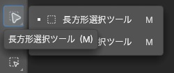
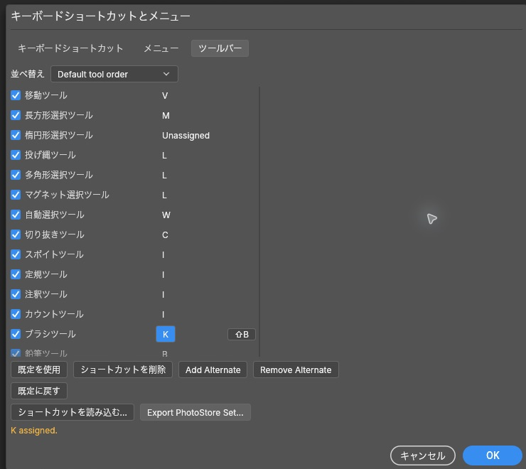
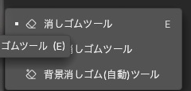
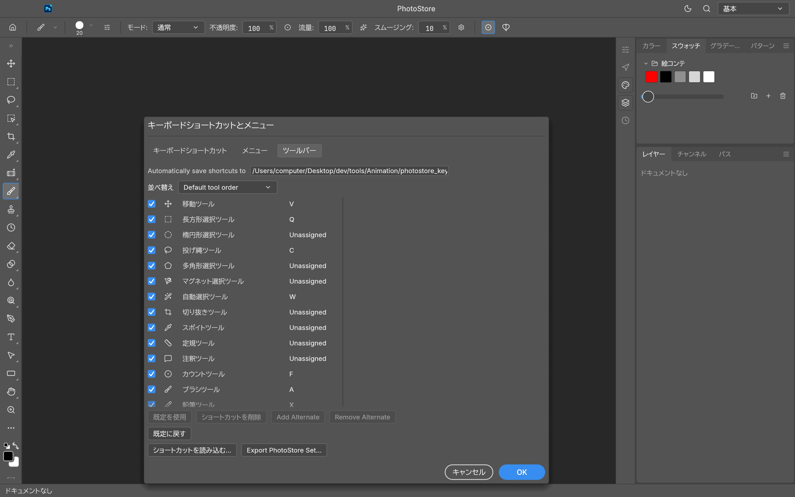

# PhotoStore

Native, open-source image editing software written in Rust.


## Install

Download the macOS Apple Silicon package from the [PhotoStore releases](https://github.com/akiyamasho/PhotoStore/releases). For a local install, use Rust stable 1.95+:

```sh
CARGO_BUILD_JOBS=1 cargo install --path apps/photostore --bin photostore --locked
CARGO_BUILD_JOBS=1 cargo install --path apps/photostore-cli --bin photostore-cli --locked
```

Linux native dependencies and optional fonts are documented in [`docs/development.md`](docs/development.md).

Optional native movie import/export requires FFmpeg and FFprobe; install the Homebrew `ffmpeg-full` formula or set `PHOTOSTORE_FFMPEG` and `PHOTOSTORE_FFPROBE`.

## Build and run

```sh
CARGO_BUILD_JOBS=1 cargo build --release -p photostore -p photostore-cli
./target/release/photostore
./target/release/photostore-cli --help
open -a PhotoStore
```

For the normal local edit loop, use the isolated [`PhotoStore-dev` installation](docs/dev-install.md)
and [`development watcher`](docs/dev-watch.md). It incrementally builds and safely restarts the
dev process while preserving protected documents and recovery state; it does not change the
production `PhotoStore.app`.

## Latest screenshots

The 0.13.0 preview documents editable per-tool and subtool shortcuts, clear bindings, native JSON
export, and the fresh rectangular marquee configuration.







See the [0.13.0 screenshot evidence and gallery](docs/screenshots/0.13.0/evidence.md) for capture
scope, demo-document details, and known limits.

The 0.13.1 dev-watch capture shows the tool icons and native shortcut-file autosave field in the
consolidated `PhotoStore-dev` workflow. It uses a disposable blank document and does not claim to
show the later CI release event.



See the [0.13.1 screenshot evidence](docs/screenshots/0.13.1/evidence.md) for the exact preview
source, capture hash, runtime path, and known limits.
