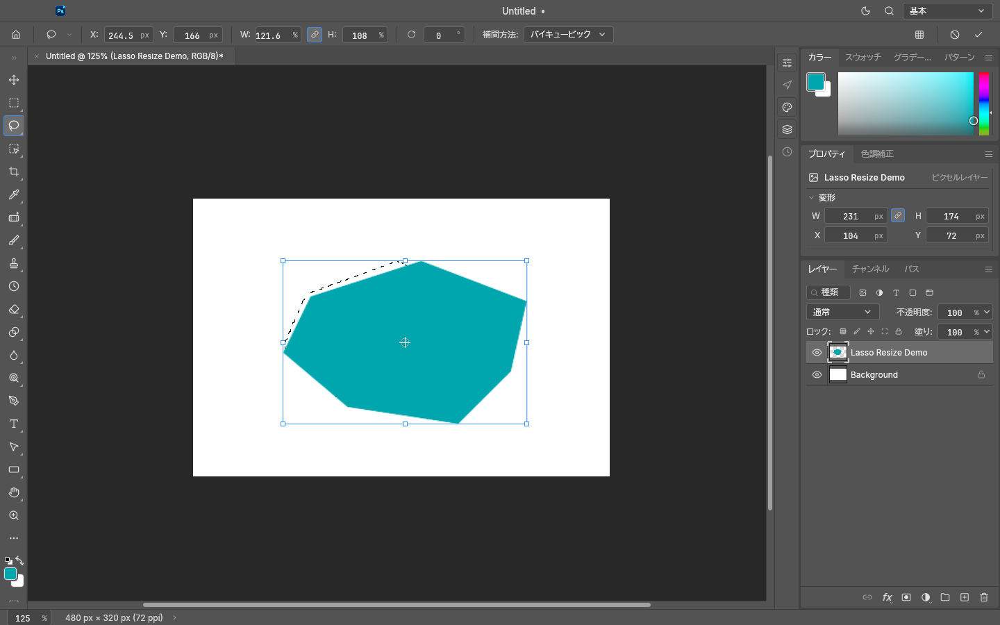
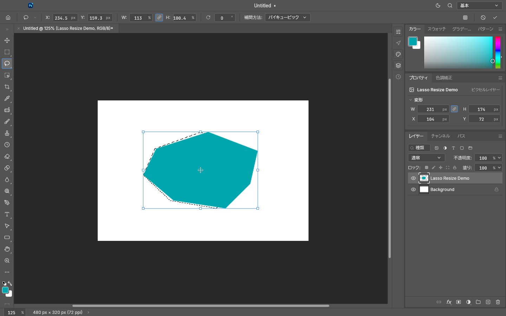
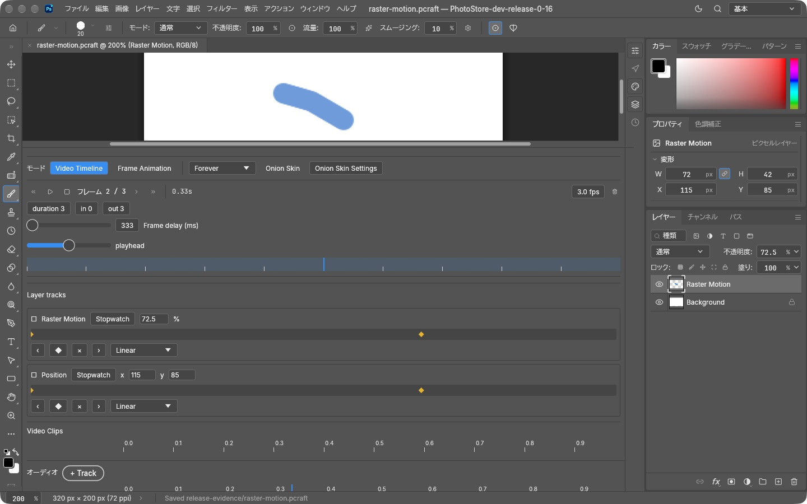
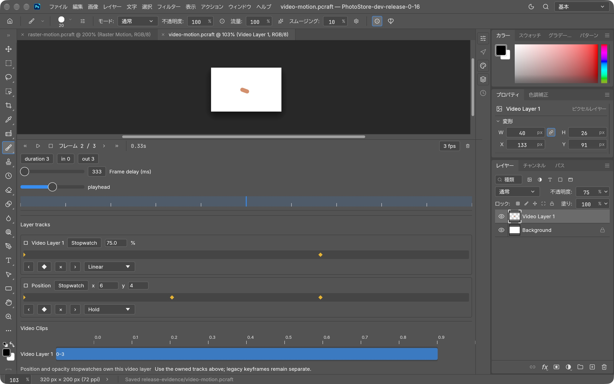

# PhotoStore

PhotoStore is a Rust-native image editor maintained as a personal fork of PhotoCraft. It is an independent project; no upstream sync relationship is configured.


## Install

Download the macOS Apple Silicon package from [PhotoStore releases](https://github.com/akiyamasho/PhotoStore/releases). For a local install, use Rust stable 1.95+:

```sh
CARGO_BUILD_JOBS=1 cargo install --path apps/photostore --bin photostore --locked
CARGO_BUILD_JOBS=1 cargo install --path apps/photostore-cli --bin photostore-cli --locked
```

## Build and run

```sh
CARGO_BUILD_JOBS=1 cargo build --release -p photostore -p photostore-cli
./target/release/photostore
./target/release/photostore-cli --help
```

## Current source release

PhotoStore 0.17.0 adds configurable Generative Fill to the ARM64 macOS app and CLI. The packages
are built and installed; publication status and artifact checksums are recorded in the
[0.17.0 release notes](docs/releases/0.17.0.md).

## Generative Fill

Select an area, choose **Edit → Generative Fill…**, and describe the change. Local Codex uses the
full image and selection as context; custom adapters can connect other models and services.
Results arrive on an undoable layer, clipped to the selection and matched to surrounding colors
and lighting. Matching can be disabled to preserve the provider's exact colors.


See [setup and provider contract](docs/generative-fill.md) and [capture evidence](docs/screenshots/0.17.0/evidence.md).
Initial scope: sRGB RGB documents up to 25 million pixels, with 8-bit PNG provider interchange.

## Historical preview screenshots

These 0.16.1 preview captures show a Lasso-selected pixel layer resized freely and then resized inward with Shift constraining its current aspect ratio. They remain historical preview evidence, not 0.16.2 release evidence. See the [0.16.1 release notes](docs/releases/0.16.1.md) and [capture evidence](docs/screenshots/0.16.1/evidence.md).





Earlier 0.16.0 development-preview captures show raster and video Position/Opacity tracks. See the [capture evidence](docs/screenshots/0.16.0/evidence.md) and [v0.16.0 release](https://github.com/akiyamasho/PhotoStore/releases/tag/v0.16.0).





Historical captures remain linked with their original provenance: [0.14.0 close and timeline evidence](docs/screenshots/0.14.0/evidence.md) and [0.13.1 toolbar/shortcut evidence](docs/screenshots/0.13.1/evidence.md).
