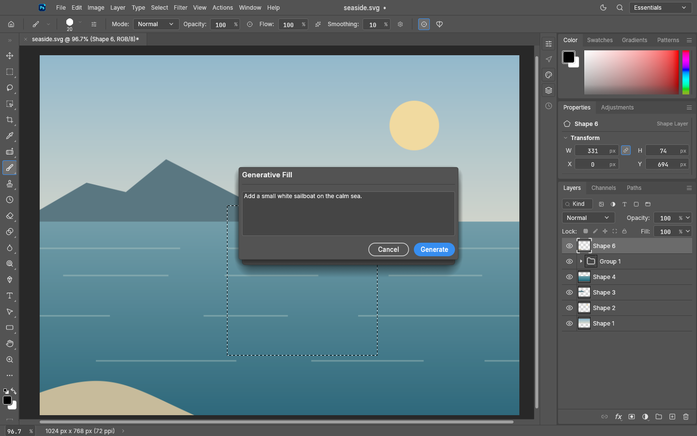
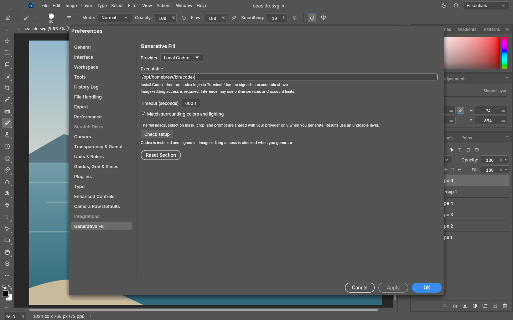
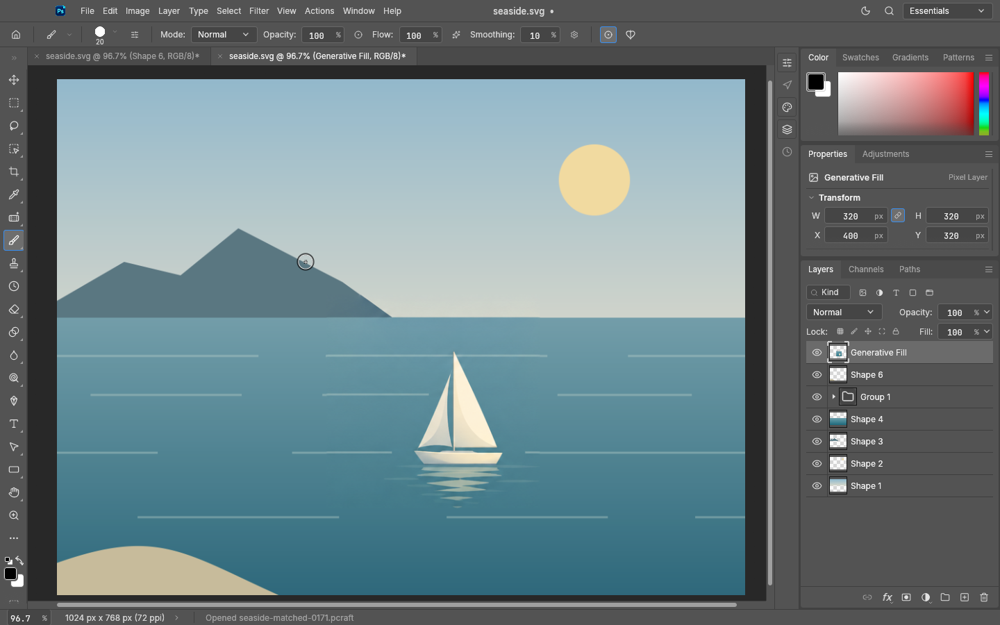
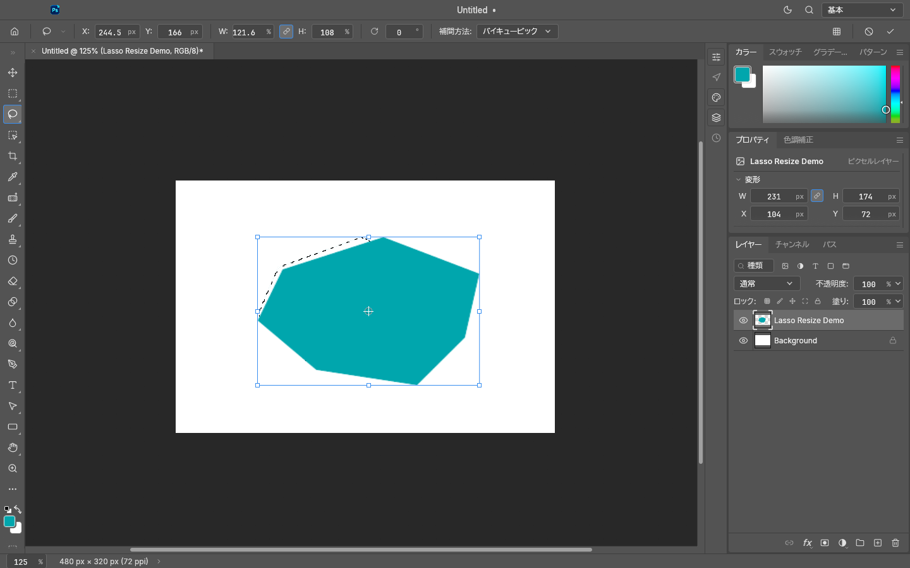
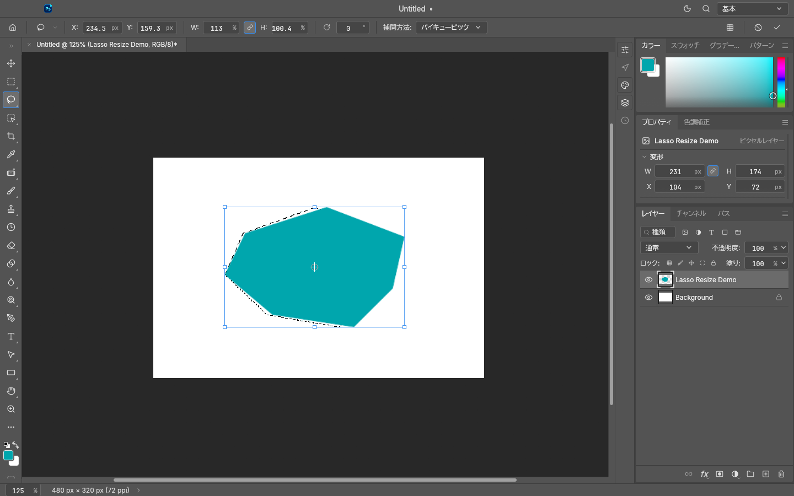
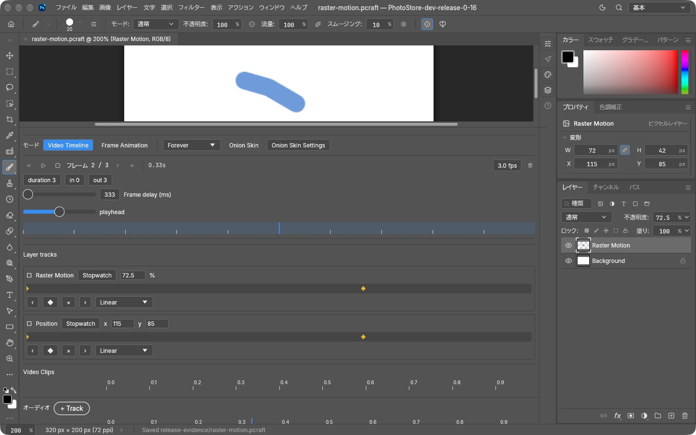
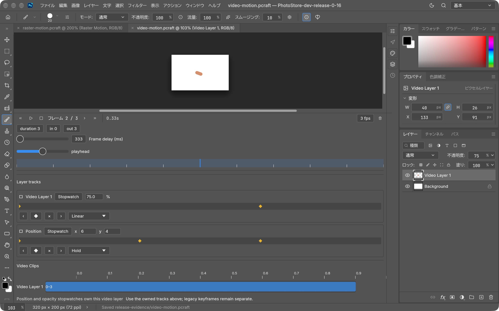

# PhotoStore

PhotoStore is a Rust-native image editor maintained as a personal fork of PhotoCraft. It is an independent project; no upstream sync relationship is configured.


## Install

Download the macOS Apple Silicon package from [PhotoStore releases](https://github.com/akiyamasho/PhotoStore/releases). For a local install, use Rust stable 1.95+:

The 0.20.1 Apple Silicon macOS app adds persistent preview decoding, shared frame data and
adaptive media caching, and removes fixed 64 MiB timeline-authoring rejections. Stable-release
checks are available under **Help → Check for Updates…** using your existing GitHub CLI (`gh`)
authentication. The app and CLI are signed with a persistent
local PhotoStore certificate, not Developer ID and not notarized. See [in-app update details](docs/app-updates.md)
and the [0.20.1 release record](docs/releases/0.20.1.md).

```sh
CARGO_BUILD_JOBS=1 cargo install --path apps/photostore --bin photostore --locked
CARGO_BUILD_JOBS=1 cargo install --path apps/photostore-cli --bin photostore-cli --locked
```

## Build and run

```sh
CARGO_BUILD_JOBS=1 cargo build --release -p photostore -p photostore-cli
./target/release/photostore
./target/release/photostore-cli --help
```

## Current published release

PhotoStore 0.20.1 improves movie presentation preparation through persistent decoding, shared
copy-on-write pixel and animation data, and playback-aware background scheduling. Large frame
conversion/tween operations use the configured Memory Usage allowance with background cancellation
and atomic undo, replacing their fixed 64 MiB threshold.
[Download 0.20.1](https://github.com/akiyamasho/PhotoStore/releases/tag/v0.20.1).
The [release record](docs/releases/0.20.1.md) separates measured core performance from pending
native playback acceptance. See the [implementation plan](docs/plans/scalable-playback-2026-11-01.md)
and [generated design reference](docs/design/2026-11-01/smooth-playback/workflow.png).
Derived media borrows an adaptive cache budget; it is not a total process-memory cap. Native v3
archives preserve editable layers, Smart Objects and timeline data with v1/v2 migration; older
readers cannot open v3. HDR conversion and native CapCut-speed acceptance remain unsupported or
unverified, respectively. Distinct codec, recording-archive and configurable load quotas remain.

The previous [0.20.0 release](https://github.com/akiyamasho/PhotoStore/releases/tag/v0.20.0) added
source identity/relinking, rational project rates, optional proxies, sample-clocked native audio,
affine Smart animation and original-source exports.
The prior [0.19.0 release](https://github.com/akiyamasho/PhotoStore/releases/tag/v0.19.0) includes
rename text clipboard support, 1 px brush decrease, drawing, cursor and PSD timelapse fixes.

The previous [0.18.3 release](https://github.com/akiyamasho/PhotoStore/releases/tag/v0.18.3) added the
selection-scoped Generative Fill context bar, retained in this release.

## Generative Fill

Select an area, choose **Edit → Generative Fill…**, enter a prompt, and choose **Generate**.
The full image provides context. Results arrive on an undoable layer, clipped to the selection
and matched to surrounding colors and lighting.



Configure Local Codex or a custom provider in **Preferences → Generative Fill**. If local setup
is incomplete, **Open Settings** takes you directly there and keeps your prompt.





See [setup and adapter contract](docs/generative-fill.md) and [capture evidence](docs/screenshots/0.17.1/evidence.md).
Initial scope: sRGB RGB documents up to 25 million pixels, with 8-bit PNG provider interchange.

## Historical preview screenshots

These 0.16.1 preview captures show a Lasso-selected pixel layer resized freely and then resized inward with Shift constraining its current aspect ratio. They remain historical preview evidence, not 0.16.2 release evidence. See the [0.16.1 release notes](docs/releases/0.16.1.md) and [capture evidence](docs/screenshots/0.16.1/evidence.md).





Earlier 0.16.0 development-preview captures show raster and video Position/Opacity tracks. See the [capture evidence](docs/screenshots/0.16.0/evidence.md) and [v0.16.0 release](https://github.com/akiyamasho/PhotoStore/releases/tag/v0.16.0).





Historical captures remain linked with their original provenance: [0.14.0 close and timeline evidence](docs/screenshots/0.14.0/evidence.md) and [0.13.1 toolbar/shortcut evidence](docs/screenshots/0.13.1/evidence.md).
