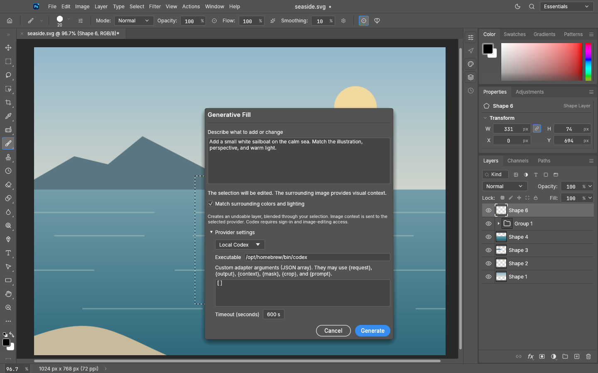
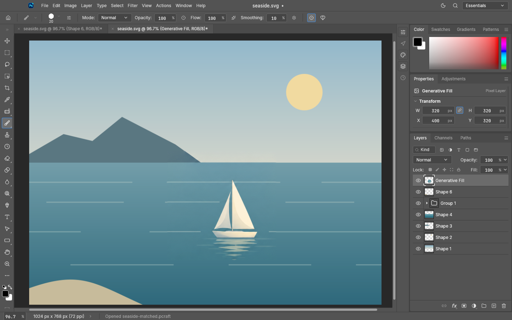

# PhotoStore 0.17.0 — Generative Fill

Status: final ARM64 packages built, verified, and installed on 2026-10-18. These packages were not published; the stable release is [0.17.1](0.17.1.md). Immutable source/tag target: `7bcc810ace56320943da02c5c40b3dc4f72ecb4d` (`v0.17.0`).

- **Edit → Generative Fill…** uses the selected area and the full image together to guide an edit.
- Local Codex is the default provider. Custom executable/argument adapters can connect other local
  models and services through a documented image-and-mask contract.
- Exact patch or full-canvas output is placed at the original coordinates, clipped to the original
  feathered selection, on a new undoable layer. Existing layers remain intact.
- Default boundary matching uses the existing gradient-domain solver to match surrounding colors
  and lighting; it can be disabled to retain the provider’s exact colors.
- Generation runs in a cancellable background job with a timeout, validates provider output, and
  leaves the document unchanged when it fails.
- Provider settings persist. Credentials stay with the selected provider. Untrusted automation
  cannot launch arbitrary provider executables.

This release extends 0.16.2 and includes the previously integrated close safety, timeline
persistence, development-watcher, position/opacity animation, and editing fixes.

See [Generative Fill setup and adapter contract](../generative-fill.md). Codex requires an existing
sign-in and image-editing tool access. Local orchestration does not imply offline inference.
Generative quality depends on the provider; pixel-accurate placement does not guarantee a natural
semantic match. Transparent generated pixels reveal the original image underneath.

Initial scope: sRGB RGB documents up to 25 million pixels, with 8-bit PNG provider interchange.
Generated content has 8-bit precision; existing higher-depth layer data remains intact.

## Screenshots

See [capture provenance and limits](../screenshots/0.17.0/evidence.md).

## Artifacts and verification

- `photostore-0.17.0-macos-aarch64.dmg` — 44,294,334 bytes — SHA-256 `b176f84bd24c86279e42470843669a8c3e84ff140e916939fa40966a2cb03e3c`
- `photostore-cli-0.17.0-macos-aarch64.zip` — 31,870,642 bytes — SHA-256 `9acabecd3c2cea0c6db667c1346f70e5d06cf1f79b5aee503848f8540496e0f5`

The final app and CLI are ARM64, version 0.17.0, with the full baked source SHA above. Package
integrity, bundle identity, attribution/font licenses, signatures, and artifact checksums passed.
The DMG uses APFS to avoid synthesized FinderInfo metadata in HFS hybrid images on this Mac.
Artifacts are ad hoc signed and not notarized. Only the requested generation/capture workflow
was exercised; no general test suite or native OS input-routing acceptance is claimed.

Installed app: `/Applications/PhotoStore.app`; executable SHA-256
`817e393b9390c6ff9f427e05f3660a01e1ef61dcc14d9b29caf7b352a0bc194e`. Installed CLI: `/Users/computer/tools_bin/photostore-cli`;
executable SHA-256 `20d5cbf60ee973a72c5f8927b40fb041a5ac0c3c5c5b5451d35989ec6021d1b3`. Previous app backup:
`/Applications/.PhotoStore.backup.v0.17.0.1792299354.app`. Scheduler remains disabled and unloaded because a supported no-replay handoff
is unavailable; publication and documentation pushes must not cause another build.
