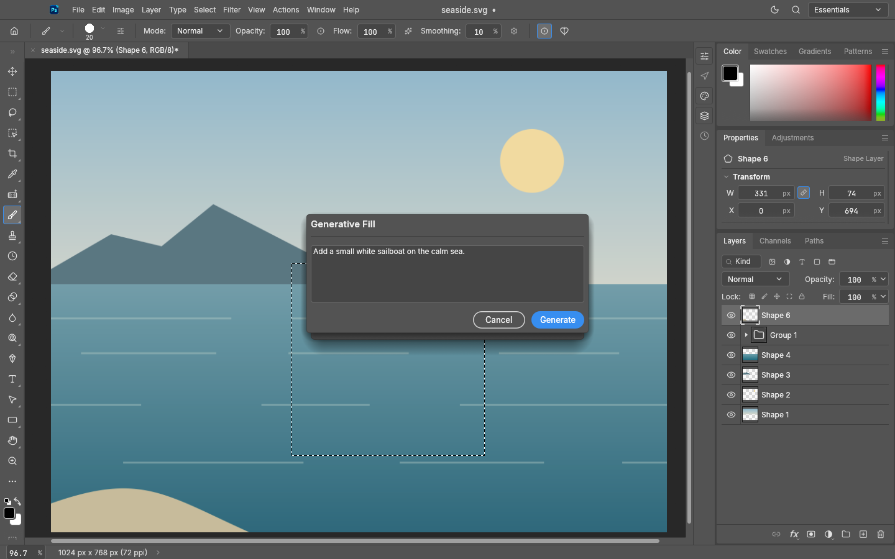
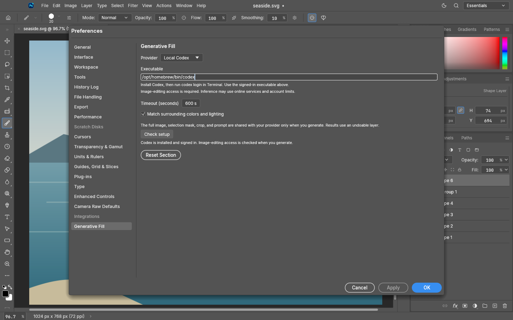
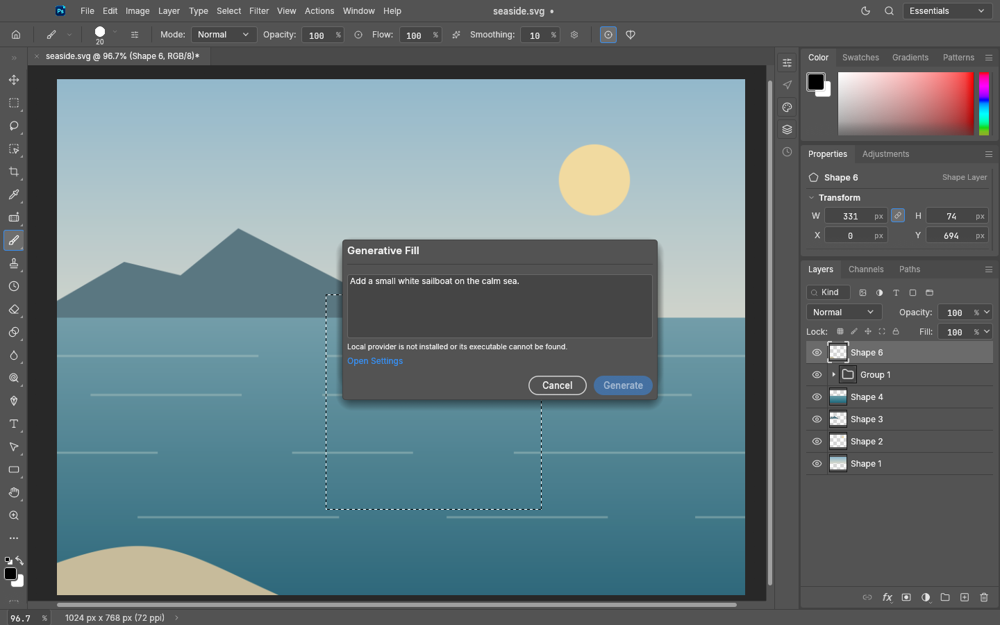
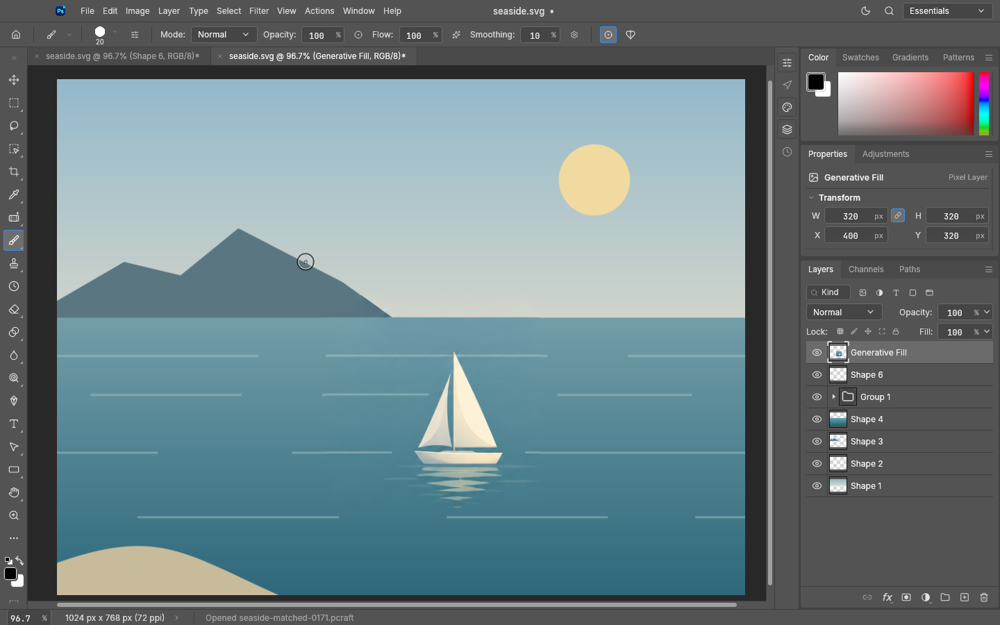

# PhotoStore 0.17.1 — Simple Generative Fill

Status: final ARM64 app and CLI built, verified, and installed on 2026-10-18; publication pending.
Immutable source/tag target: `9b96ad80ad2d5222ca6fa790754c62e48dc733a1` (`v0.17.1`).

- Generative Fill is a simple prompt with Generate and Cancel.
- Provider configuration and color matching move to **Preferences → Generative Fill**.
- Missing local executable or Codex sign-in shows **Open Settings**, directly opening that section
  while preserving the prompt. **Check setup** refreshes readiness after local setup.
- Includes configurable full-context generative fill, exact selection clipping, undoable layers,
  and boundary matching introduced by the 0.17.0 source tag.

See [setup and adapter contract](../generative-fill.md). Initial scope: sRGB RGB documents up to
25 million pixels; 8-bit PNG provider interchange. Local Codex orchestration may use online
services and requires image-editing access. Boundary matching does not guarantee every semantic
transition. No general test suite or native OS input-routing acceptance is claimed.

## Screenshots

See [capture provenance and limits](../screenshots/0.17.1/evidence.md).

## Artifacts and installation

- `photostore-0.17.1-macos-aarch64.dmg` — 44,301,813 bytes — SHA-256 `a9ebed26555d9e9a5047395b70ad22db3cbaeb61ca9a1ae652a006fc46523df4`
- `photostore-cli-0.17.1-macos-aarch64.zip` — 31,870,885 bytes — SHA-256 `550504a935a6f4507aa165a621e87ef962b90d9d41dc9dca3d95443ae09a5ebb`

Version, full baked source SHA, ARM64 architecture, production bundle identity, package integrity,
strict signatures, attribution/font licenses, and checksums passed. Artifacts are ad hoc signed,
not notarized. The same verified bytes were installed locally.

App: `/Applications/PhotoStore.app`, executable SHA-256 `0c13ae81827ac4bf121c561ecfcc35897fd96be0defa76be9afbd02dbc513e7d`.
CLI: `/Users/computer/tools_bin/photostore-cli`, executable SHA-256 `87b6560aee484b53f1714df378555b3a223298507b63503889230898ef26af0c`.
Previous bundle backup: `/Applications/.PhotoStore.backup.v0.17.1.1792300611.app`.

The earlier `v0.17.0` source tag remains immutable; its packages were not published. This release
includes that implementation and the prompt-only refinement. Screenshot/documentation commits
follow the source tag without changing its artifact source or rebuilding the binaries.

The local CI scheduler remains disabled and unloaded because no supported no-replay handoff is
available. Pushes, tags, and publication do not trigger another build. No general test suite was run.
