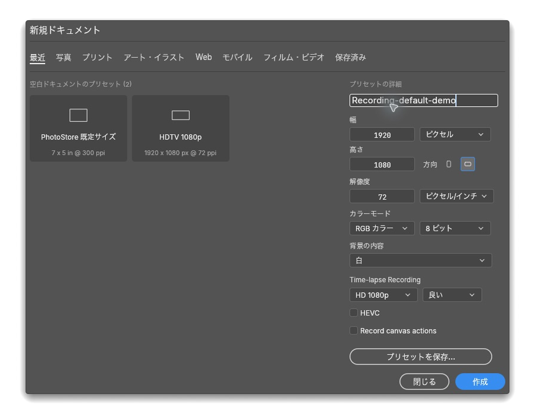
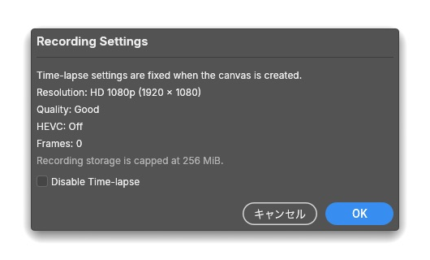

# PhotoStore release screenshots

Each release screenshot lives under `docs/screenshots/<version>/` and is committed before the
final release tag. The release notes and root README embed the exact committed files. Keep the
images limited to the released feature or fix, captured in disposable demo documents; exclude
private, unsaved, or unrelated artwork.

For each release, add a small evidence note beside the images covering the feature or fix, demo
document, source version or SHA, visible verification, and known limits. Use lossless PNG or
readable WebP. The 0.12.0 captures are available in [the release evidence](../releases/0.12.0.md)
and the [0.12.0 evidence folder](0.12.0/).

